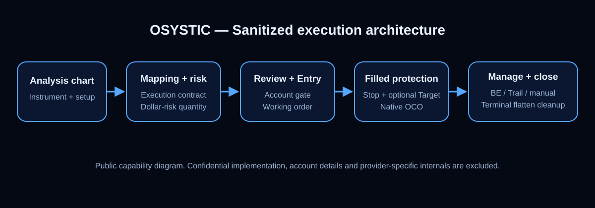

# NinjaTrader 8 Cross-Instrument Execution & Risk Automation — Engineering Case Study

> **OSYSTIC ENGINEERING CASE STUDY · PUBLIC SHOWCASE · SANITIZED · PORTFOLIO-SAFE**
>
> This repository contains **no client identity, no confidential NinjaScript source, no account identifiers or balances, no provider credentials, no private screenshots, no commercial terms and no private conversations**.

## Company showcase classification

| Attribute | Public classification |
|---|---|
| Publisher | **OSYSTIC** |
| Artifact type | Engineering case study / capability proof |
| Platform | NinjaTrader 8 / NinjaScript (C#) |
| Domain | Futures execution and risk-management tooling |
| Source engagement | Completed client engineering engagement |
| Publication model | Sanitized public showcase with independent Git history |
| Confidential implementation | Excluded and retained privately |
| Trading-performance claim | None |
| Intended use | Portfolio, proposals, technical due diligence, capability review |

## What this repository is

An anonymized engineering case study of a NinjaTrader 8 execution and trade-management system built for discretionary futures workflows. The engagement combined cross-instrument analysis/execution mapping, fixed-dollar risk sizing, chart-driven order geometry, explicit review/confirm, native protective orders, breakeven automation, trailing-stop automation and defensive closeout handling.

The public artifact demonstrates the engineering approach and validated behavior without reproducing the confidential implementation.

## Engagement outcome

The project was completed, live-tested under controlled conditions and handed over with recovery artifacts.

- Full-size analysis to micro-contract execution was validated for **two primary futures families**.
- Working Entry modifications were synchronized to the actual platform order state.
- Pending Stop/Target planning remained editable without cancelling a valid Entry.
- After fill, protective Stop and optional Target were created with a shared OCO relationship.
- Post-fill protective-order modifications were reflected in the platform's actual order state.
- Final Close All validation confirmed a flat position, cancelled protection and **no orphan protection recreation**.
- The final accepted panel version was **v0.4.25**.
- Multi-account master/follower copying was intentionally deferred as a future, separately scoped enhancement.

This is an engineering outcome, not a claim of trading profitability or future performance.

## OSYSTIC PACE

### P — Problem & constraints

A discretionary futures workflow needed the convenience of analyzing a larger contract while executing a mapped micro contract, with risk defined in dollars rather than guessed quantity. The trader also needed chart-driven Entry/Stop/Target control, optional runner behavior, breakeven and trailing automation, and a safe transition from simulation to controlled live execution.

The design had to preserve explicit human confirmation, respect the actual filled execution state, fail closed for unsupported account/provider paths and avoid leaving protection behind after a position was intentionally flattened.

### A — Architecture & decisions

The solution separated **analysis instrument**, **execution instrument**, **risk engine** and **live order state**. Cross mappings convert the chart context into the execution contract. Quantity is derived from execution-instrument point value and initial Stop distance under a fixed-dollar cap. The panel then moves through review, Entry submission, fill-aware protection and trade-management states.

Pre-fill Stop/Target values are treated as planned geometry. Post-fill protection is created against the actual position. Fixed-target protection uses a native OCO relationship. Breakeven and trailing logic only tighten protection in the favourable direction. A dedicated flatten guard makes flat state terminal for the protection lifecycle.

### C — Contribution & delivery

OSYSTIC engineered the NinjaScript/C# panel, integrated chart interaction and account/order handling, configured cross-instrument workflows, performed simulation UAT, enabled a restricted live-account path, diagnosed live-only regressions, implemented corrective releases and completed final backup/handover documentation.

The closeout preserved a frozen simulation/UAT baseline separately from the final live version so future changes can start from a known accepted state.

### E — Evidence & outcomes

The final controlled live acceptance covered Entry submission, pending Entry modification, pending protection planning, fill, actual protective OCO creation, post-fill Stop/Target modification, Close All, protection cancellation and final flat state.

During UAT, three important live-management defects were discovered and corrected rather than concealed: unsafe pending-Entry cancellation during transient Stop movement, chart/broker Entry-price desynchronization, and a Close All race that could recreate protection after flattening. The final release passed the regression path for all three.

## Public vs private boundary

| This public showcase | Confidential delivery repository |
|---|---|
| Sanitized architecture | Full NinjaScript/C# implementation |
| PACE engineering narrative | Detailed source and closeout artifacts |
| Capability-level validation results | Internal live-UAT evidence |
| Generic order lifecycle | Account/provider-specific operating state |
| Engineering lessons | Private screenshots/logs/conversations |
| Safe portfolio metadata | Native backup/export recovery artifacts |

## Technology

`NinjaTrader 8` · `NinjaScript / C#` · `WPF/chart interaction` · `futures order management` · `OCO protection` · `fixed-dollar risk sizing` · `state-machine automation` · `GitHub Actions`

## What is intentionally not claimed

This showcase does **not** claim:

- guaranteed profitability, win rate, ROI or loss prevention;
- ownership or publication rights to confidential client implementation details;
- identical execution across every broker/provider, contract, feed, latency profile or NinjaTrader build;
- that simulated fills equal live fills;
- that the public repository can rebuild the confidential panel;
- that multi-account trade copying is part of the completed version;
- that the system generates trading signals or market alpha.

## Read more

- [Full PACE case study](case-study.md)
- [Technical overview](docs/technical-overview.md)
- [Architecture](docs/architecture.md)
- [Validation methodology](docs/validation-methodology.md)
- [Public results summary](docs/results-summary.md)
- [Engineering lessons](docs/lessons-learned.md)
- [Disclosure boundary](docs/disclosure-boundary.md)
- [Publication record](docs/publication-record.md)

## Governance and publication

This repository follows OSYSTIC GitHub Governance Operating System v2.2. It has an independent sanitized Git history and is not a fork, mirror or source export of the confidential delivery.

- Business/accountable and technical owner: Shawaiz Arif / `@osystic`
- Publication approval: [docs/publication-record.md](docs/publication-record.md)
- Ownership/reuse: [OWNERSHIP.md](OWNERSHIP.md)
- Security/disclosure: [SECURITY.md](SECURITY.md)
- Maintenance/withdrawal: [docs/runbook.md](docs/runbook.md)
