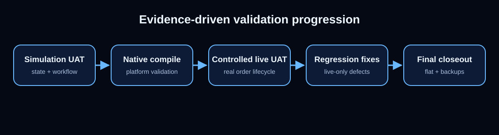

# Validation Methodology

The delivery used layered validation instead of relying on one type of test.

## Layers

1. source/static review;
2. controlled compile checks;
3. native NinjaTrader compilation;
4. simulation UAT;
5. controlled live execution UAT;
6. targeted regression after every live-only defect;
7. final recovery/backup handover.

## Final controlled live path

The accepted lifecycle validated:

- account/provider gate;
- Entry submission;
- Working Entry modification;
- pending Stop/Target plan changes;
- fill detection;
- protective OCO creation;
- post-fill protective changes;
- Close All;
- protection cancellation;
- no orphan protection recreation;
- final flat state.

## Why live UAT mattered

Simulation and compile success did not expose every state/race condition. The final defects appeared around transient chart interaction, broker-confirmed Working state and flatten/protection event ordering. Each was converted into a reproducible regression condition before closeout.

## Boundary

No public evidence exposes account identifiers, provider credentials, private screenshots or confidential implementation source. The absence of those artifacts is a disclosure control, not a claim that validation did not occur.
